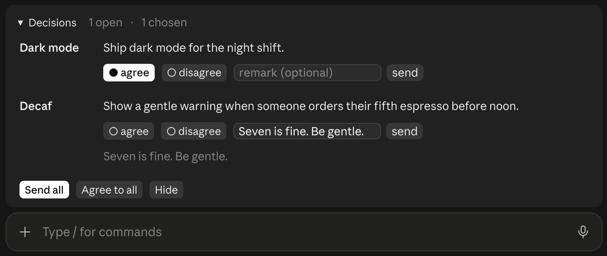
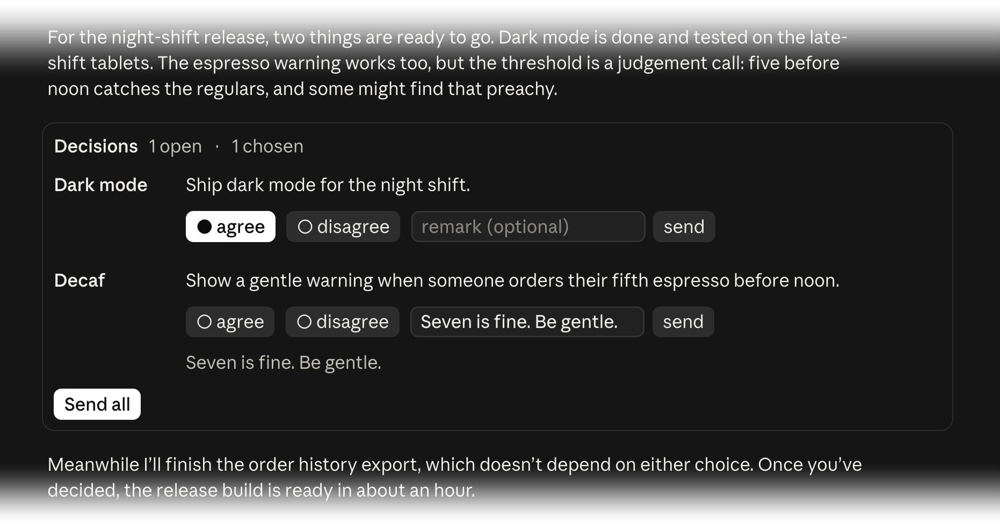
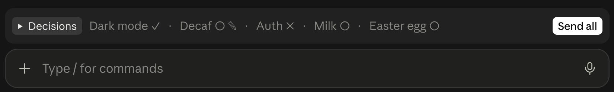
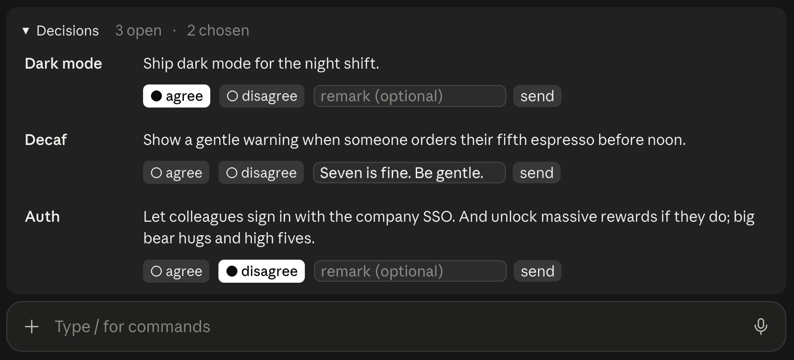

# decision-bar

A [Claude Code](https://claude.com/claude-code) mod for working through many decisions without
losing track of them.

When Claude needs your input, the decisions it proposes go into a bar above the input field
instead of interrupting the conversation. They wait there while you keep working: do some
research, ask Claude to change something in between, look into something else. Answer them when you are
ready, in the order you choose — agree or disagree, add a remark, send one or all at once. The
bar always shows what is still open and what you have already decided.



## Install

At the prompt of a terminal session:

```
/plugin install decision-bar --marketplace michielwittkampf/decision-bar
```

From a shell:

```bash
claude plugin install decision-bar --marketplace michielwittkampf/decision-bar
```

In the desktop app:

```
Click + next to the prompt box, then Plugins → Add marketplace → michielwittkampf/decision-bar → Add plugin
```

Works in the desktop app (Code tab) and in the terminal; on mobile with buttons only.

## Why use it

- **Many decisions, one overview.** As many open decisions as you need, each with its own choice
  and remark, and a heading that counts what is open and what is chosen. New questions join the
  list instead of replacing it.
- **Decide in context.** The decisions also appear in the chat, right next to Claude's
  reasoning. Answer there while you read, or later in the bar. In the terminal you type a remark
  in the bar; the box in the chat shows it.

  

- **Your order, your pace.** Nothing blocks the conversation. Answer one decision now and leave
  the rest while you dig into them; Claude can keep working in the meantime.
- **Out of the way when you need the room.** Collapsed, the bar is a single line with the state of
  every decision, and the conversation gets the space back. Answered something in the chat
  instead? Claude takes it off the list.

  

- **In your language.** Buttons, counts and answers follow the language of the chat.

  

## What would make it better

Things the mod works around today, as feedback for the Claude Code team and for other mod authors,
each with its issue on anthropics/claude-code where one is filed. The decision bar itself is
proposed as a built-in feature in
[#103281](https://github.com/anthropics/claude-code/issues/103281).

- **A text input that grows with its text**
  ([#103305](https://github.com/anthropics/claude-code/issues/103305)). The desktop app draws an
  `Input` at a fixed width on one line. One that widens to the room on the line and then wraps onto
  more lines as you type would show the whole remark while you write it, without a separate
  full-remark line below.
- **A focus event for a click into a field**
  ([#103306](https://github.com/anthropics/claude-code/issues/103306)). The desktop app raises
  `ui.focus` when Tab moves through the band above the prompt and when focus leaves it, but not when
  you click into an `Input`. The mod commits a typed remark as soon as focus moves on; after a click
  into another field it has to wait until you type there.
- **Text inputs that keep their scroll**
  ([#103302](https://github.com/anthropics/claude-code/issues/103302)). A redraw keeps an `Input`'s
  cursor where it was, but the desktop app scrolls the field back to the start of its text, so once
  a remark is wider than the field you no longer see where you type. The mod therefore keeps typed
  text out of shared state until your next action. A field that keeps its scroll across redraws
  would let the counts and the full remark update live.
- **Tool groups that stay open**
  ([#103303](https://github.com/anthropics/claude-code/issues/103303)). The desktop app folds
  consecutive tool calls into a collapsed group and does not honour a mod's `isExpanded` on it, so a
  decision box next to another tool call is hidden. Claude is told to keep text between them.
- **Keys for rows in the chat.** In the terminal only the band above the prompt and panes take
  keys, so a field in a transcript row can be shown but not typed in. The decision box there shows
  the remark as text and leaves typing to the bar; the desktop app takes input in the chat, and
  keeps the field.
- **Visible refusals** ([#103304](https://github.com/anthropics/claude-code/issues/103304)). When
  the engine refuses a mod's drawing, an installed mod falls back to the app's own row without a
  word; the reason is only in the debug log.
- **Spacing in proportional layouts.** Margins come in whole character cells, which is coarse in
  the desktop app.

## Developing

| Path | What |
|---|---|
| `hooks/register.tsx` | the tool, Claude's instructions, state and the bar |
| `hooks/decision-bar.test.tsx` | behaviour tests (terminal and desktop) |
| `types/index.d.ts` | type contract of the state |
| `.claude-plugin/` | manifest and marketplace file |

1. Run your checkout with `claude --plugin-dir .`, or install it from the folder:
   `claude plugin marketplace add .` and `claude plugin install decision-bar@decision-bar`.
2. Change the code and tests; check with `claude plugin validate .` and `claude plugin test .`.
3. In a running session, `/reload-plugins` picks up the change.

The `plugin-authoring` skill in Claude Code has the mod API for your version. Things to know:

- Typed text lives in `drafts`, not in `$.state`, and is committed by `commitDrafts` on any other
  action; reading goes through `currentRemarks`. Keep it that way. Writing `$.state` on every
  keystroke redraws the field: the cursor stays where it was, but the desktop app scrolls the
  field back to the start of its text, so a remark wider than the field is typed out of sight. A
  test with short text does not show this.
- Tool arguments sit flat in `e` (`e.proposals`); in tests `$.tool.call({ tool, proposals })`.
- `next` is reserved inside a hooks module: an inner variable named `next` stops it from loading.
- The test kit has no `$.store`; `setup` in the tests provides one.
- A tree the engine refuses (a prop out of range, such as a width of `-Infinity` from
  `Math.max()` over an empty list) is replaced by the app's own drawing without any visible
  error in an installed plugin: the reason is only in the debug log (`claude --debug`). Run the
  checkout with `--plugin-dir .` to see refusals as a line in the transcript, and in tests
  `$.ui.mount` rejects with the reason.

## License

MIT — see [LICENSE](LICENSE).
