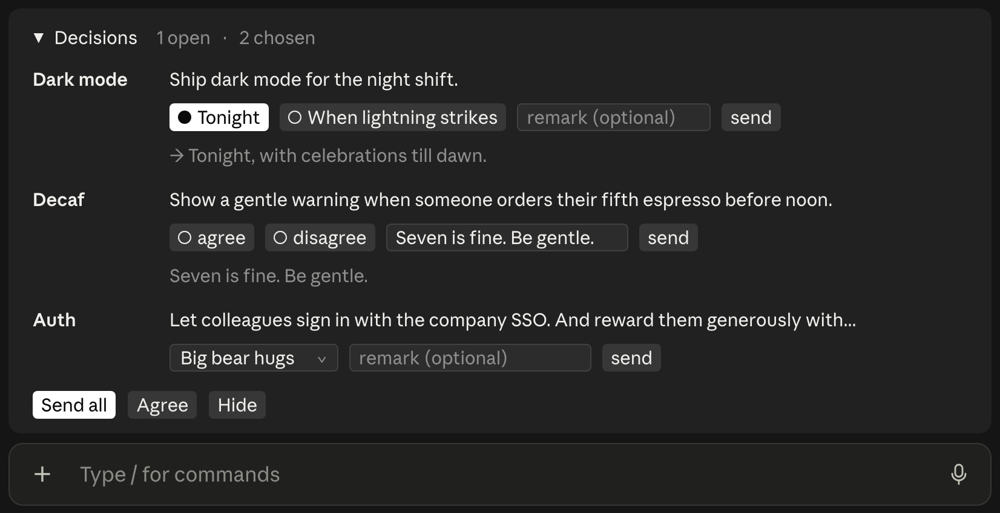
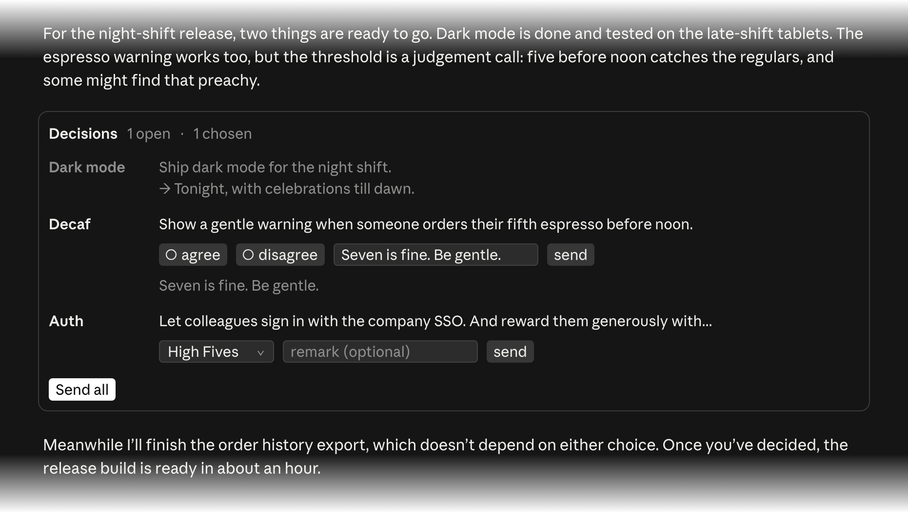
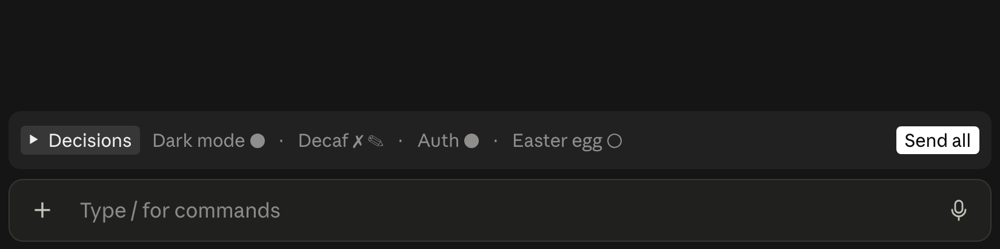
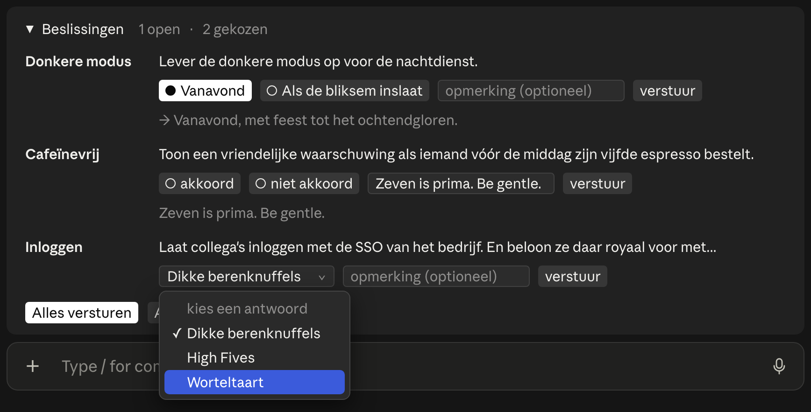

# decision-bar

Work through (many) decisions without losing track, at your own pace and in your own order. A
[Claude Code](https://claude.com/claude-code) mod.

When Claude needs your input, the questions no longer get buried in its reply. Every decision it
asks for goes into one bar above the prompt, and shows in context in the chat as well, the two
kept in sync. Each stays clearly open until you answer it or it no longer applies. Meanwhile you
keep working: dig into one, ask Claude to change something, come back to the rest. Then agree,
disagree or add a remark, and send one or all at once.



## Install

At the prompt in the desktop app or in a terminal session:

```
/plugin install decision-bar --marketplace michielwittkampf/decision-bar
```

From a shell:

```bash
claude plugin install decision-bar --marketplace michielwittkampf/decision-bar
```

Works in the desktop app (Code tab) and in the terminal, and on mobile with buttons only. Not yet
in a side chat of the desktop app, where Claude asks in the chat instead
([#103429](https://github.com/anthropics/claude-code/issues/103429)).

## Why use it

- **One overview instead of questions scattered through the text.** However many decisions are
  open, they are together in one place, each with its own choice and remark, and a heading that
  counts what is open and what is chosen. New questions join the list instead of replacing it.
- **Your order, your pace.** Nothing blocks the conversation. Answer one decision now and leave
  the rest while you dig into them; Claude can keep working in the meantime.
- **Decide in context.** The decisions also appear in the chat, right next to Claude's
  reasoning. Answer there while you read, or later in the bar. Afterwards the box keeps showing
  what you decided and which remark went with which decision, so scrolling back shows each answer
  next to its question. In the terminal you type a remark in the bar; the box in the chat shows
  it.

  

- **Nothing gets lost.** A decision stays visibly open until you answer it. Answered it in the
  chat, or has it been overtaken? Claude takes it off the list. Hidden decisions come back with
  `/decisions`; with nothing hidden, `/decisions` has Claude put the decisions still open in the
  conversation back, for when the bar lost them (after a rewind, for example).
- **More than yes or no.** Agree or disagree with a remark, or send just a remark: it goes out
  with the decision it is about, so Claude knows exactly what it refers to. Where the answer is
  not yes or no, Claude gives the decision its own answers ("Commit now", "Run the tests first",
  "Not yet"): two as buttons, more in a menu. An answer can carry a longer text, which the row
  shows in full once you choose it, and which is what is sent. None of them fits? Choose the circle
  just before the remark field (in a menu: "other…") and type your own answer in the field: it is sent as the answer, and the
  decision leaves the bar.
- **Out of the way when you need the room.** The bar starts collapsed: a single line with the
  state of every decision, so the conversation keeps its space. Click the heading to open it, and
  again to fold it away; it stays as you left it for the rest of the session.

  

- **In your language.** Buttons, counts and answers follow the language of the chat.

  

## More

- [What the mod does](docs/how-it-works.md): every hook, what it sends in your name and what it
  keeps, with notes for the plugin directory's reviewers. The short version is in
  [PRIVACY.md](PRIVACY.md).
- [What would make it better](docs/what-would-make-it-better.md): what the mod works around in
  Claude Code today, each with its issue.
- [Developing](DEVELOPING.md): files, running and testing a checkout, and the pitfalls of the mod
  API.
- [Changelog](CHANGELOG.md).

## License

MIT — see [LICENSE](LICENSE).
